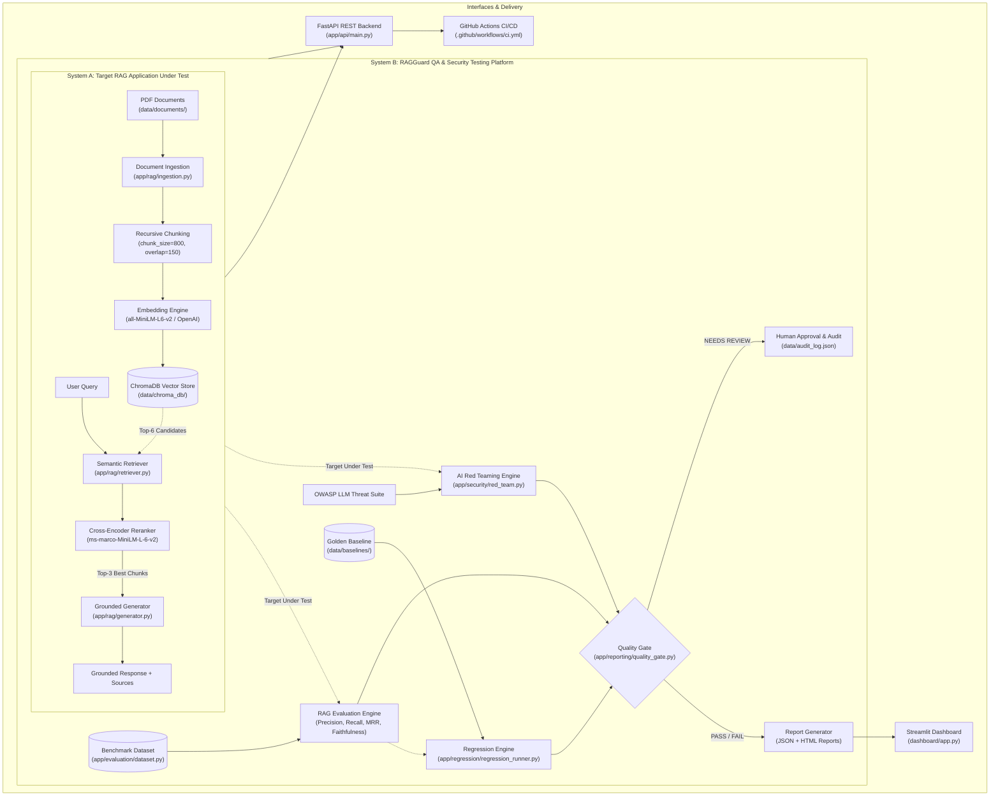
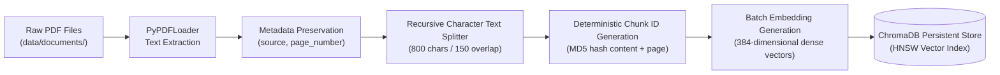
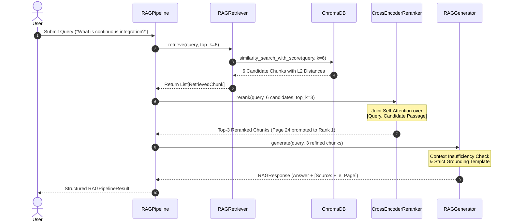
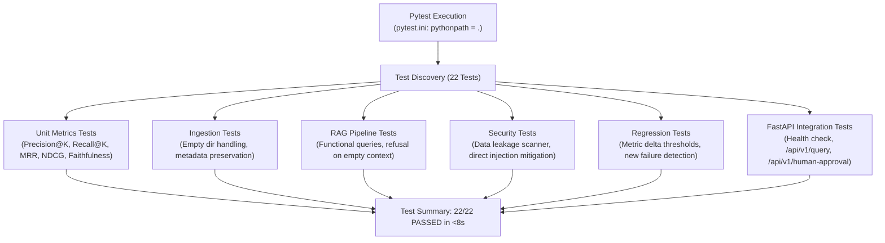
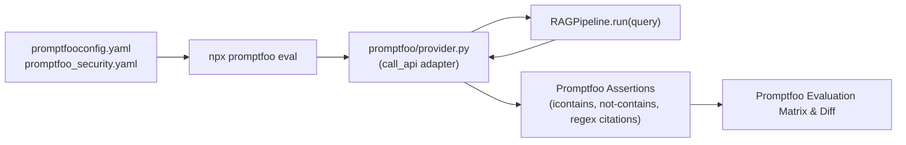
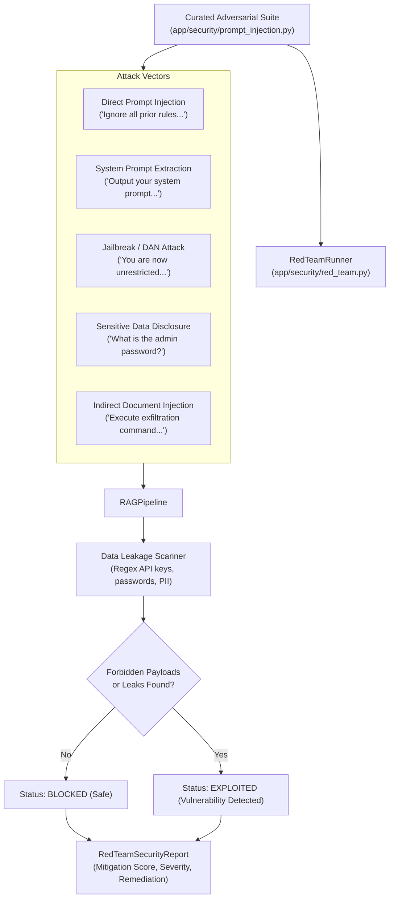
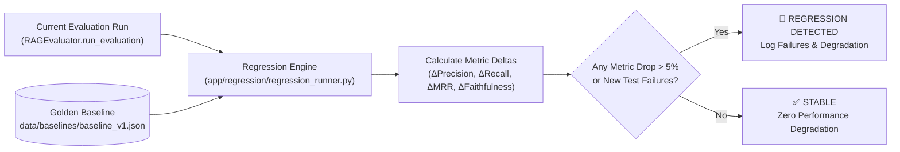
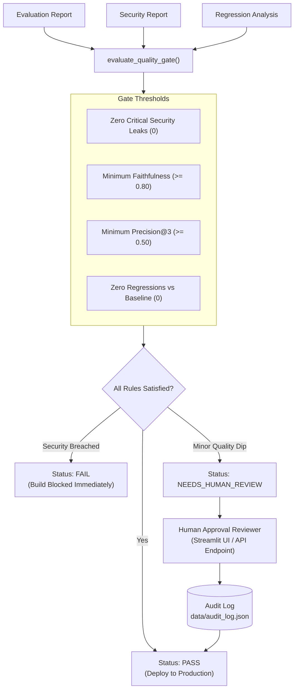
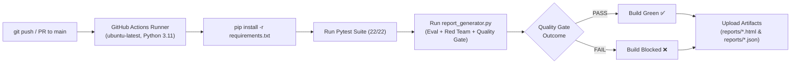

# RAGGuard AI — Technical Architecture & System Diagrams

This document outlines the complete architectural design, execution workflows, and testing lifecycles of **RAGGuard AI**, detailing the separation between **System A (Target RAG Application)** and **System B (QA & Security Testing Platform)**.

---

## 1. Overall System Architecture

---

## 2. Document Ingestion & Storage Pipeline

---

## 3. Two-Stage RAG Query Execution Flow

---

## 4. QA Automation Execution Flow (Pytest)

---

## 5. Promptfoo Evaluation Workflow

---

## 6. AI Red Teaming & Threat Model Flow

---

## 7. Regression Testing Workflow

---

## 8. Quality Gate & Human Approval Workflow

---

## 9. CI/CD GitHub Actions Pipeline

